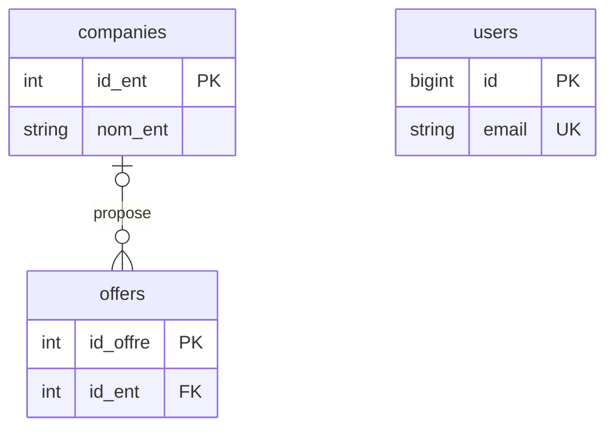

# Modèle de données : état constaté et MCD à valider

Ce document fait avancer l’[issue #1](https://github.com/kenftt/projet-web/issues/1)
en décrivant le schéma versionné sur `master` au commit `466d6a28` : dictionnaire,
dépendances fonctionnelles et points à trancher avant de valider les formes normales.
Il ne décrit pas une base de production inspectée et ne constitue pas une validation
des règles métier. Aucune migration n’est proposée dans ce lot.

## Sources et périmètre

Les trois entités métier effectivement présentes dans les migrations sont
`users`, `companies` et `offers`.

- [Création des utilisateurs](../database/migrations/2012_03_27_195452_create_users_table.php)
  et [colonnes de double authentification](../database/migrations/2014_10_12_200000_add_two_factor_columns_to_users_table.php).
- [Création des entreprises](../database/migrations/2021_03_27_160856_create_companies_table.php).
- [Création des offres](../database/migrations/2021_03_28_172318_create_offers_table.php)
  et [clé étrangère offre → entreprise](../database/migrations/2021_03_28_172319_add_foreign_keys_to_offers_table.php).
- Modèles [Company](../app/Models/Company.php), [Offer](../app/Models/Offer.php),
  [User](../app/Models/User.php) et [users](../app/Models/users.php).
- Contrôleurs [entreprises](../app/Http/Controllers/CompanyController.php),
  [offres](../app/Http/Controllers/OfferController.php) et
  [utilisateurs](../app/Http/Controllers/usersController.php).

Les tables de fonctionnement Laravel (`password_resets`, `sessions`,
`personal_access_tokens`, `failed_jobs`) sont hors du MCD métier de ce lot.
Leurs migrations restent la référence technique. Une référence technique à un
utilisateur dans ces tables ne prouve aucune association utilisateur–offre.

## Dictionnaire des données existantes

Les types ci-dessous reprennent les déclarations Laravel, sans supposer un SGBD
particulier. « Oui » dans la colonne NULL signifie que la migration autorise une
valeur absente. PK = clé primaire ; FK = clé étrangère ; UQ = unicité déclarée.

### Utilisateur — table `users`

| Champ | Déclaration / NULL | Sens constaté et contrainte |
| --- | --- | --- |
| `id` | `id()` / non | Identifiant technique, PK auto-incrémentée. |
| `name` | `string(50)` / oui | Nom ; présenté comme « Nom » dans le formulaire. |
| `email` | `string` / non | Adresse de connexion, UQ. |
| `email_verified_at` | `timestamp` / oui | Date de vérification de l’adresse. |
| `password` | `string` / non | Mot de passe haché par le contrôleur et l’authentification. |
| `cv` | `string(50)` / oui | Référence de CV présumée ; format et gestion du fichier non définis ici. |
| `role` | `tinyInteger` / oui | Code de rôle ; valeurs et cumul éventuel de rôles à préciser. |
| `remember_token` | `rememberToken()` / oui | Jeton technique d’authentification persistante. |
| `two_factor_secret` | `text` / oui | Secret technique de double authentification. |
| `two_factor_recovery_codes` | `text` / oui | Codes techniques de récupération. |
| `created_at`, `updated_at` | `timestamps()` / oui | Horodatages techniques gérés par Eloquent. |

Les données d’authentification ne doivent pas apparaître dans un export métier
du dictionnaire ou des utilisateurs. Ce tableau décrit uniquement leur structure.

### Entreprise — table `companies`

| Champ | Déclaration / NULL | Sens constaté et contrainte |
| --- | --- | --- |
| `id_ent` | `integer`, auto-incrément / non | Identifiant technique, PK. |
| `nom_ent` | `string(50)` / non | Nom de l’entreprise ; aucune unicité déclarée. |
| `secteur_ent` | `string(50)` / non | Secteur sous forme de texte libre. |
| `adresse_ent` | `string(50)` / non | Adresse sous forme de texte libre. |
| `stagiaire_pris` | `integer` / non | Nombre de stagiaires pris ; période et méthode de calcul à définir. |
| `note_stagiaire_ent` | `integer` / non | Note stagiaire ; échelle et caractère individuel/agrégé à définir. |
| `note_pilote_ent` | `integer` / non | Note pilote ; échelle et caractère individuel/agrégé à définir. |
| `created_at`, `updated_at` | `timestamps()` / oui | Horodatages techniques. |

### Offre — table `offers`

| Champ | Déclaration / NULL | Sens constaté et contrainte |
| --- | --- | --- |
| `id_offre` | `integer`, auto-incrément / non | Identifiant technique, PK. |
| `duree_stage` | `integer` / non | Durée en semaines d’après le formulaire de création. |
| `renumeration` | `float(10, 0)` / non | Montant ; devise, périodicité et précision métier non spécifiées. Orthographe du champ conservée. |
| `lm` | `string(50)` / non | Champ du formulaire « Lettre de motivation » ; nature et rattachement à une candidature à clarifier. |
| `fiche_valid` | `string(50)` / non | Champ de fiche de validation ; format non spécifié. |
| `convention_stage` | `string(50)` / non | Champ de convention de stage ; format non spécifié. |
| `nb_place` | `integer` / non | Nombre de places ; bornes non déclarées dans la migration. |
| `competence` | `string(50)` / non | Texte de compétence ; multiplicité et référentiel à définir. |
| `id_ent` | `integer` / oui | FK vers `companies.id_ent`, indexée. |
| `created_at`, `updated_at` | `timestamps()` / oui | Horodatages techniques. |

La FK interdit une référence à une entreprise inexistante et utilise `RESTRICT`
pour la suppression et la mise à jour de la clé d’entreprise. Aucun index unique
sur `offers.id_ent` ne limite le nombre d’offres par entreprise.

## Associations et cardinalités constatées

Le diagramme suivant représente le modèle relationnel existant, qui sert de base
au MCD. Les noms physiques sont conservés pour permettre la vérification du code.

| Association | Côté entreprise | Côté offre | Preuve / décision restante |
| --- | --- | --- | --- |
| Proposer une offre | 0 à N offres | 0 à 1 entreprise | FK nullable et non unique. Le contrôleur exige pourtant `id_ent` : décider si la cardinalité métier doit être 1 à 1 côté offre. |
| Utilisateur–offre | Non représentée | Non représentée | Aucune table de candidature ni FK entre ces entités dans les migrations. |

L’absence d’association dans le schéma ne signifie pas qu’elle est inutile au
produit. Les candidatures, favoris, centres et promotions ne peuvent pas être
ajoutés au MCD définitif sans préciser leurs règles de gestion.

## Matrice des dépendances fonctionnelles

Une clé détermine tous les attributs de sa propre ligne. Pour rendre la matrice
lisible, les colonnes regroupent les attributs suivants :

- **U** : attributs de `users` hors `id` et `email`, y compris les horodatages.
- **E** : attributs de `companies` hors `id_ent`, y compris les horodatages.
- **O** : attributs de `offers` hors `id_offre` et `id_ent`, y compris les horodatages.

`→` indique une dépendance garantie par les clés déclarées ; `=` est l’identité ;
`—` indique qu’aucune dépendance n’est établie par ce schéma.

| Déterminant | `users.id` | `users.email` | U | `companies.id_ent` | E | `offers.id_offre` | `offers.id_ent` | O |
| --- | --- | --- | --- | --- | --- | --- | --- | --- |
| `users.id` | = | → | → | — | — | — | — | — |
| `users.email` (UQ non NULL) | → | = | → | — | — | — | — | — |
| `companies.id_ent` | — | — | — | = | → | — | — | — |
| `offers.id_offre` | — | — | — | — | — | = | → | → |

Il s’agit des dépendances internes aux relations. Dans la jointure des offres
ayant une entreprise, `offers.id_offre → offers.id_ent → attributs entreprise`.
Les attributs d’entreprise sont justement stockés dans `companies`, ce qui évite
leur duplication dans chaque offre. La FK seule n’implique pas la dépendance
inverse : une entreprise peut proposer plusieurs offres.

Aucune unicité ne permet d’affirmer `nom_ent → id_ent`, `name → id` ou
`competence → id_offre`. Les dépendances métier supplémentaires restent à établir.

## Évaluation des formes normales

| Forme | Ce que le code permet de constater | Ce qu’il reste à valider |
| --- | --- | --- |
| 1FN | Les entités métier ont des clés et des colonnes scalaires. | Confirmer que `competence` et `secteur_ent` ne contiennent pas des listes à manipuler séparément ; préciser la structure métier des documents. |
| 2FN | Les clés candidates identifiées sont simples (`id`, `email`, `id_ent`, `id_offre`) : pas de dépendance partielle sur une clé composite connue. | Vérifier d’éventuelles clés candidates métier non déclarées. Le constat suppose la 1FN validée. |
| 3FN | Aucune dépendance transitive interne n’est établie par les seules contraintes ; l’entreprise est séparée de l’offre. | Recueillir les dépendances métier des notes, stages, candidatures et rôles avant de conclure. Une PK artificielle ne prouve pas à elle seule la 3FN. |

Si une offre possède plusieurs compétences réutilisables, une entité `Compétence`
et une association offre–compétence seraient à envisager. Si chaque utilisateur
émet sa propre note, une entité d’évaluation avec auteur et date serait nécessaire
pour préserver ces informations ; la note affichée pourrait alors être calculée.
Ces pistes sont conditionnelles et ne sont pas des règles métier approuvées.

## Écarts vérifiés et décisions nécessaires

| Point | Observation vérifiable | Prochaine décision ou correction à préparer |
| --- | --- | --- |
| Utilisateurs | `usersController` et les formulaires utilisent `prenom`, `delegue`, `pilote`, `admin`, `id_centre`, `id_promotion`, absents des migrations. Le modèle `users` ne rend pas tous ces champs assignables. | Choisir le modèle de rôles et définir centre/promotion avant de réconcilier migrations, modèles et formulaires. |
| Date de l’offre | `Offer::$fillable` contient `date_offre`, absent des migrations. | Déterminer si une date de publication distincte de `created_at` est nécessaire. |
| Entreprise obligatoire | `offers.id_ent` est nullable ; `OfferController::store/update` le déclare `required`. | Aligner cardinalité métier, schéma et validation, en traitant les anciennes offres sans entreprise. |
| Documents | Lettre de motivation, fiche de validation et convention sont portées par l’offre. Aucune candidature n’est modélisée. | Confirmer s’il s’agit de modèles de documents pour l’offre ou de documents personnels d’une candidature. |
| Rémunération | `float(10, 0)` ne définit ni devise ni période ; les contrôleurs n’exigent que la présence du champ. | Définir devise, unité et précision, puis choisir un type exact adapté. |
| Notes et effectifs | Des entiers sont saisis directement sur l’entreprise. | Définir échelles, période, auteur et calcul éventuel ; ne pas inventer d’historique. |

## Conditions pour terminer l’issue #1

- [x] Décrire le dictionnaire des trois tables métier existantes et citer ses sources.
- [x] Établir les dépendances fonctionnelles garanties par leurs clés déclarées.
- [x] Documenter les cardinalités actuelles et les écarts avec l’application.
- [ ] Valider les règles métier et les dépendances manquantes avec les responsables du projet.
- [ ] Produire le MCD cible avec les cardinalités retenues et justifier sa normalisation.
- [ ] Réconcilier le schéma et l’application, puis tester création, modification,
  suppression et intégrité référentielle sur une base de test.

Vérification effectuée pour ce document : lecture des migrations, modèles,
contrôleurs et formulaires versionnés. Aucun résultat de migration, de test
applicatif ou de validation métier n’est revendiqué.
